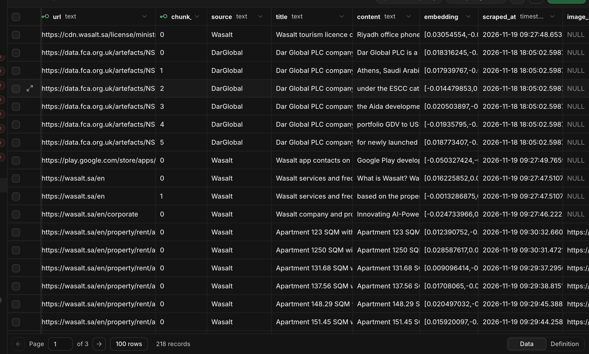

# DarGlobal Property Assistant

DarGlobal Property Assistant is a proof-of-concept (POC) AI chatbot that helps users explore DarGlobal developments and search for properties listed on Wasalt.

**Live demo:** https://darglobal-frontend-production.up.railway.app

## Key Features

- Search properties by city, price, property type, and number of bedrooms.
- Find properties available for sale or rent.
- Ask questions in natural language and refine searches through conversation.
- Explore DarGlobal developments and company information.
- Open original Wasalt listings for more details.

## Technology Stack

- **Frontend:** Next.js, React, TypeScript
- **Backend:** Python, FastAPI
- **Database:** Supabase PostgreSQL and pgvector
- **AI:** OpenRouter, with optional OpenAI fallback
- **Web scraping:** Python, HTTPX, Beautiful Soup
- **Deployment:** Railway and Docker

## How It Works

1. The user sends a message through the chatbot.
2. The FastAPI backend processes the request and manages the conversation.
3. Supabase retrieves matching properties or relevant development information.
4. The AI generates a response using the retrieved information.
5. Users can open the original property listings for more details.

Property data is collected from Wasalt and DarGlobal sources using a Python scraping pipeline.

## Current POC Architecture

For this POC, I kept the project in a **single monorepo** because of the limited development time. This made it easier to build, test, and deploy quickly.

The frontend and backend run as separate Railway services, while the scraping pipeline currently runs manually.

## Screenshots

### Chatbot Interface

### Supabase Database

### Railway Deployment

## Future Improvements

1. **Separate services:** Manage the frontend, backend, and scraper independently to make debugging, maintenance, scaling, and deployment easier.
2. **Automated scraping:** Schedule the scraping pipeline to collect new properties, update existing listings, and keep the database current.
3. **Monitoring:** Add logs, error tracking, and alerts to identify issues faster.
4. **Testing:** Add automated tests for property searches, conversation memory, and multi-city searches.
5. **Data reliability:** Improve detection of outdated or unavailable listings.
6. **Long-term scraper tooling.** Evaluate Selenium with headless Chrome or Chromium for approved sources that require JavaScript rendering or browser interaction. Keep HTTPX and Beautiful Soup for pages that expose listing data directly in HTML. For sources that explicitly permit specialized HTTP clients, evaluate Cloudscraper where appropriate. Prefer an approved feed or API for frequent refreshes.

## Conclusion

This POC shows how AI can make property discovery easier through natural conversation. The monorepo helped deliver a working demo within a short timeframe. Separating services and automating the scraping pipeline would make the system easier to maintain and more reliable for production.
